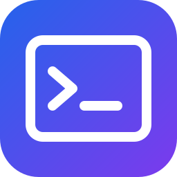

<p align="center">
  
</p>

<h1 align="center">Shell Scripts</h1>

<p align="center">
  <b>Cross-platform shell configuration; a modular environment setup for Bash and Zsh.</b>
</p>

<p align="center">
  My main shell scripts for macOS, Ubuntu Desktop, and Omarchy.<br>
  <i>By Brian Nunez.</i>
</p>

<p align="center">
  
  
  
</p>

<p align="center">
  <a href="https://github.com/brian-nunez/shell-scripts"></a>
</p>

<p align="center">
  <a href="https://github.com/brian-nunez/shell-scripts"><b>GitHub</b></a> ·
  <a href="https://www.linkedin.com/in/brianjnunez/">LinkedIn</a>
</p>

<p align="center">
  <sub><b>Personal shell environment</b>: shared configuration, helpers, aliases, and dependency checks across three desktop platforms.</sub>
</p>

<p align="center">
  <a href="#quick-start">Quick start</a> ·
  <a href="#why-shell-scripts">Why Shell Scripts</a> ·
  <a href="#features">Features</a> ·
  <a href="#supported-platforms">Supported platforms</a> ·
  <a href="#documentation">Documentation</a>
</p>

## Why Shell Scripts

- **Modular.** `init.sh` loads focused scripts in a fixed order, so shell setup, language runtimes, tools, helpers, aliases, and local secrets stay separated.
- **Cross-platform.** The same entry point supports macOS ARM64, Ubuntu Desktop 24 AMD64, and Omarchy x86_64 while keeping platform-specific paths isolated.
- **Repeatable.** PATH updates and completion setup avoid duplicate entries when the shell configuration is sourced again.
- **Practical.** The setup combines everyday navigation, Git, Docker, language-runtime, Arduino, tmux, and optional AI tooling in one environment.

## Quick start

Clone the repository into the directory expected by the loader:

```bash
git clone https://github.com/brian-nunez/shell-scripts.git "$HOME/shell-scripts"
```

Source the entry point from `~/.zshrc` or `~/.bashrc`:

```bash
source "$HOME/shell-scripts/init.sh"
```

Validate the local environment before opening a new terminal:

```bash
cd "$HOME/shell-scripts"
./validate.sh
```

`validate.sh` detects the current supported platform, checks required dependencies, reports installation commands for missing tools, and exits non-zero when required checks fail.

## Features

| Feature | Description |
| ------- | ----------- |
| **Shell prompts** | Bash and Zsh prompts show the current user, directory, and Git branch. |
| **Idempotent PATH setup** | Adds `~/.local/bin`, Go binaries, and optional tool directories without duplicating entries. |
| **Runtime initialization** | Loads NVM when installed, selects Java 21 on macOS, initializes rbenv, and adds Go tooling. |
| **Completions** | Configures Docker completions for Bash and Zsh and uses the Zsh completion cache. |
| **Fuzzy navigation** | `goto`, `gotogit`, and `gco` use fzf to navigate directories, repositories, and local Git branches. |
| **Convenience aliases** | Includes `vim` for Neovim, `gtg` for `gotogit`, `air` for Go Air, and platform-aware application aliases. |
| **Optional integrations** | Supports Tailscale, Arduino CLI, tmux configuration reloads, Ghidra, Artcraft tools, and LM Studio paths when installed. |

## Supported platforms

| Platform | Shell | Notes |
| -------- | ----- | ----- |
| macOS ARM64 | Zsh or Bash | Homebrew, macOS Java discovery, and optional Tailscale application support. |
| Ubuntu Desktop 24 AMD64 | Bash or Zsh | Uses apt-based installation guidance and supports a local Neovim installation. |
| Omarchy x86_64 | Bash or Zsh | Uses pacman-based installation guidance and supports Omarchy detection. |

Other operating systems and architectures are rejected by `validate.sh` so unsupported configurations do not appear valid.

## Dependencies

The validator checks these required tools:

- Git
- Go
- Java 21
- Node.js and npm
- Neovim 0.11 or newer
- Docker
- rbenv
- fzf
- tmux
- Arduino CLI

Tailscale is optional. Arduino CLI also requires an initialized configuration and the `arduino:renesas_uno` core. Platform-specific installation commands are maintained in [Dependencies and Installation](docs/dependencies.md).

## Local secrets

If present, `secrets.sh` is loaded last by `init.sh` and is ignored by Git. Keep personal credentials in that file only, and never commit it.

## Documentation

- [Architecture and design](docs/architecture.md)
- [Dependencies and installation](docs/dependencies.md)
- [Tools, functions, and aliases](docs/tools.md)

## Validation

Run the dependency checker from the repository directory:

```bash
./validate.sh
```

Set `NO_COLOR` when a non-color report is needed:

```bash
NO_COLOR=1 ./validate.sh
```
